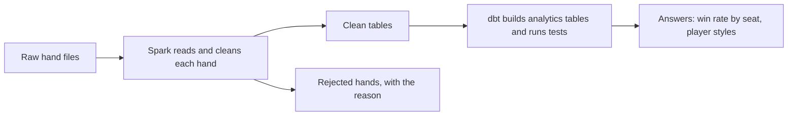

# poker-lakehouse

# Poker Hand-History Pipeline

A data engineering project that takes **40,000+ real online poker hands**, cleans them up, and answers
questions like *"which seat at the table wins the most?"*

Built with **Python, PySpark, dbt, and SQL**.

## The idea in 30 seconds

Poker sites save every hand as messy text. This project turns that text into clean tables you can query:



1. **Spark** reads the files and parses every hand: who sat where, who bet what, who won.
2. Hands that don't make sense go into a **quarantine** table with the reason, so nothing breaks or disappears silently.
3. **dbt** turns the clean tables into a star schema and result tables, then runs 23 automatic checks.

## The data

Real, anonymized PokerStars hands from 2009, from the open
[PHH dataset](https://github.com/uoftcprg/phh-dataset) (University of Toronto, MIT license).
`scripts/download_sample.py` downloads it for you.

## Results

| | |
|---|---|
| Hands read | 39,994 |
| Hands cleaned successfully | 39,956 |
| Hands rejected (inconsistent data) | 38 (0.1%) |
| Tests | 24 Python tests and 23 dbt tests, all passing |

**Finding:** seats closer to the dealer button win more, and the two forced-bet seats (blinds) lose the most.
This matches what poker theory predicts, which is a good sign the numbers are computed correctly.

## Run it yourself

You need Python 3.10+ and Java (Spark runs on it).

```bash
pip install -e ".[local,dbt,test]"

python scripts/download_sample.py --files 40 --out data/raw      # get ~40,000 real hands

# Step 1: Spark cleans the data
python -m poker_pipeline.pipeline --raw "data/raw/*.phhs" --lake data/lake --format parquet

# Step 2: dbt builds the analytics tables and runs the tests
export LAKE_PATH=$PWD/data/lake DBT_DUCKDB_PATH=$PWD/data/poker_gold.duckdb
dbt build --project-dir dbt --profiles-dir dbt --target duckdb

pytest -q                                                         # Python tests
```

## What's in the folder

| Path | What it is |
|---|---|
| `src/poker_pipeline/parser.py` | Reads one hand and checks that the chips add up |
| `src/poker_pipeline/pipeline.py` | The Spark job that runs the parser on every hand |
| `src/poker_pipeline/simulator.py` | Makes fake hands with known problems, for testing |
| `dbt/` | SQL models (the analytics tables) and data tests |
| `tests/` | Python tests |
| `databricks.yml`, `resources/` | A daily Databricks job (see the note below) |
| `.github/workflows/ci.yml` | Runs the tests automatically on every push |
| `docs/technical-notes.md` | The detailed write-up |

## Interesting problems the real data caused

- **Many hands don't record who won.** The pipeline works out the winner when everyone else folded, and
  leaves it blank when it can't tell. It never guesses.
- **Bets nobody calls are returned to the player.** The parser has to account for this, or every profit
  number would be wrong.
- **Some blinds are stored as negative numbers.** They mean a player posted out of turn.

## Honest notes

- The **Databricks job** and **Delta Lake** option are written but have not been run on a real Databricks workspace.
- The data is from 2009, from one poker site and one stake level, so it says nothing about modern play.
- Win rates only use hands where the result is known, so they are rough. Playing-style stats are more reliable.

## What I'd add next

- Load only new files instead of redoing everything
- Test it at a much larger scale and measure the speed
- A dashboard for the results
